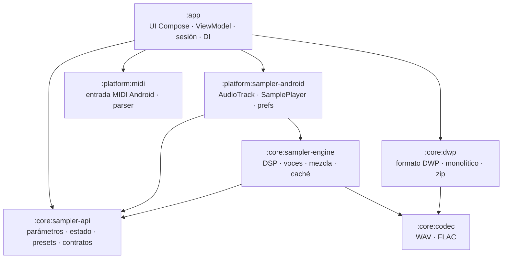

# 72 — Refactorización arquitectónica: módulos, desacoplamiento y una responsabilidad por archivo

> **Estado: ESCRITA Y VERIFICADA ESTÁTICAMENTE — NO COMPILADA NI EJECUTADA.**
> Esta refactorización se hizo en un entorno sin Kotlin, Gradle, Android SDK ni red. Lo que se
> afirma aquí como verificado lo está por análisis estático propio (§12); la primera compilación y
> la primera ejecución de tests ocurren en GitHub Actions, como en el resto del proyecto. Hasta
> entonces trátese como "escrita, auditada y verificada estáticamente, no confirmada por CI".
> Auditoría del código tocado: `Doc/73_REFACTOR_AUDIT.md`.

## 1. Objetivo

Pedido del propietario: ordenar el proyecto con criterio de producto profesional, **desacoplar los
módulos**, trabajar sobre el código real (sin parches), y que **ningún archivo combine varias
responsabilidades o lógicas**. Condición explícita: refactorización, no funcionalidad nueva; el
comportamiento de la app debe ser el mismo.

## 2. Diagnóstico previo (medido sobre el código original)

| Indicador | Antes |
|---|---|
| Módulos Gradle de producción | 1 (`:app`, todo dentro) |
| Archivos de producción / líneas | 143 / 13 882 |
| Paquetes | 16 |
| Ciclos entre paquetes | **2**: `audio ↔ audio.dsp ↔ audio.voice` y `ui.components ↔ ui.components.voice` |
| Archivos con más de una declaración pública | **20** (12 de ellos con más de un *tipo*) |
| Archivo más grande | `DwpCreatorViewModel.kt`, 706 líneas, 8 responsabilidades |
| Dependencia de la presentación | `SamplePlayer`, `SamplerFxPreferences` y `MidiInputManager` concretos instanciados dentro del ViewModel (no sustituibles ni probables) |
| Núcleo DWP | `DwpEngine` (320 líneas) mezclaba renombrado, parcheo de audio y catálogo de muestras |

Causas de los ciclos: `audio.dsp` mezclaba primitivas DSP con el *modelo de parámetros*, y
`audio.voice` mezclaba síntesis con *descriptores de parámetros*; `SamplerEngine.VoiceToken` y
`DecodedSampleCache.CachedSample` (tipos anidados) hacían que las capas bajas dependieran de las altas.

## 3. Arquitectura resultante



| Módulo | Tipo | Contenido | Depende de |
|---|---|---|---|
| `:core:codec` | Kotlin JVM | Decodificador WAV, conversión PCM, bucles `smpl`, códec FLAC | — |
| `:core:dwp` | Kotlin JVM | Bloques/documento/tokenizador DWP, `DwpRenamer`, `DwpAudioPatcher`, `DwpSampleCatalog`, `SampleZoneResolver`, exportador monolítico, E/S de zip | `:core:codec` |
| `:core:sampler-api` | Kotlin JVM | Parámetros, escalas, estados, presets, formateo, curvas de previsualización y **contratos** (`SamplerPlayback`, `FxStateStore`) | — |
| `:core:sampler-engine` | Kotlin JVM | Efectos DSP, voces (ADSR, SVF, LFO), `SamplerEngine`, caché de muestras decodificadas | `:core:sampler-api`, `:core:codec` |
| `:platform:sampler-android` | Android lib | `AudioOutputDriver`, `SamplePlayer` (implementa `SamplerPlayback`), `SamplerFxPreferences` (implementa `FxStateStore`) | `:core:sampler-api`, `:core:sampler-engine` (privada) |
| `:platform:midi` | Android lib | `MidiInput` (contrato), `MidiInputManager`, `MidiMessageParser` | — |
| `:app` | Android app | UI Compose, ViewModel, capa de sesión, raíz de composición (`di`) | `:core:dwp`, `:core:sampler-api`, `:platform:sampler-android`, `:platform:midi` |

### Estructura de carpetas

```
DwpCreator/
├── app/                        Aplicación Android: UI Compose, ViewModel, sesión, DI
├── core/                       Lógica de negocio en Kotlin puro (JVM, sin Android)
│   ├── codec/                    WAV y FLAC
│   ├── dwp/                      Formato DWP, DWP monolítico, proyectos zip
│   ├── sampler-api/              Parámetros, estados, presets y contratos
│   └── sampler-engine/           Motor de audio: DSP, voces, mezcla
├── platform/                   Integraciones con Android
│   ├── sampler-android/          Salida de audio, SamplePlayer, persistencia
│   └── midi/                     Entrada MIDI
├── baselineprofile/            Generación del Baseline Profile (rendimiento)
├── testdata/                   Archivos reales para las pruebas (Instrument.dwp)
├── tools/                      Verificaciones del repositorio (arquitectura)
├── config/                     Configuración de compilación compartida
├── Doc/                        Documentación técnica (índice en Doc/README.md)
├── .github/workflows/          CI
└── build.gradle.kts · settings.gradle.kts · gradle.properties · README.md · .gitignore
```

La carpeta refleja la capa: **`core/`** no puede depender de Android; **`platform/`** solo adapta APIs de
Android a contratos de `core/`; **`app/`** compone todo. Cada carpeta tiene su `README.md` con su
responsabilidad, API principal y qué NO debe contener.

Reglas (las hace cumplir `tools/check_architecture.py` en CI, ver §11):

* **R1** un módulo solo importa de sí mismo o de módulos que declara (y de lo que estos exponen con `api`);
* **R2** sin ciclos entre módulos;
* **R3** un archivo de producción declara como máximo **un tipo** de nivel superior y no lo mezcla con funciones/propiedades públicas sueltas;
* **R4** un paquete pertenece a un solo módulo.

Propiedades que se desprenden y que antes no eran posibles:

* Los cuatro módulos de Kotlin puro **no importan nada de `android.*`** (comprobado): sus pruebas corren en la JVM.
* **`:app` no depende de `:core:sampler-engine` ni de `:core:codec`**: la UI llega al motor solo a través de contratos. Cambiar el motor (p. ej. a Oboe/AAudio nativo) no toca la UI ni la sesión.
* El ViewModel se puede probar con dobles (`FakePlayback`, `RecordingFxStore`, `FakeLoadedSamples`).

## 4. Mapa de paquetes (antiguo → nuevo)

| Antes (`com.jvk.dwpcreator.…`) | Después |
|---|---|
| `domain.audio` (WAV, PCM, bucles) | `codec.wav` |
| `domain.audio.DecodedSampleCache` | `sampler.engine.sample` |
| `domain.flac` | `codec.flac` |
| `domain.dwp` | `dwp` |
| `domain.dwp.monolithic` | `dwp.monolithic` |
| `domain.io` | `dwp.io` |
| `audio.AudioStats` | `sampler.api` |
| `audio.dsp` — primitivas `Dsp`, `FilterScaling` | `sampler.api.math` |
| `audio.dsp` — tablas rítmicas (`RhythmTable`, `DelaySync`, `LfoSync`) | `sampler.api.rhythm` |
| `audio.voice.ChoiceOption` | `sampler.api.options` |
| `audio.dsp` / `audio.voice` — estados y enums (`SamplerFxState`, `VoiceState`, `FilterMode`…) | `sampler.api.state` |
| `audio.dsp` / `audio.voice` — descriptores (`SamplerParam`, `*Controls`, `ParamScale`…) | `sampler.api.params` |
| `audio.dsp` — presets | `sampler.api.preset` |
| `audio.voice` — `FilterResponse`, `LfoWaveforms` | `sampler.api.curve` |
| `audio.dsp` — efectos y cadena maestra | `sampler.engine.dsp` |
| `audio.voice` — voces, ADSR, SVF, LFO | `sampler.engine.voice` |
| `audio.SamplerEngine` | `sampler.engine` |
| `audio.SamplePlayer`, `AudioOutputDriver`, `SamplerFxPreferences` | `sampler.android` |
| `midi` | `midi` |
| `ui.components` (plano, 22 archivos) | `ui.components.{topbar,effects,common,dialogs,status,piano,mixer,sample}` y `ui.components.sampler.{widgets,voice}` |
| `ui.components.voice` | `ui.components.sampler.voice` |
| `MainActivity.kt` (3 declaraciones) | `MainActivity` + `ui.screens.{DwpCreatorApp,CrashDiagnosticScreen}` |
| `viewmodel` (1 archivo de 706 líneas) | `viewmodel` (fachada) + `session.*` + `di` |

Ejes del diseño: el **modelo de parámetros** (qué es un parámetro y su estado) quedó separado de la
**síntesis** (cómo suena). Por eso `:core:sampler-api` no contiene DSP y `:core:sampler-engine` no contiene
descriptores: de ahí desaparecen los ciclos. Dentro de `:core:sampler-api` las capas son
`math`/`rhythm`/`options` → `state` → `params` → `preset`, y `curve` consume `state`+`math`.

## 5. Desacoplamiento: contratos y adaptadores

| Contrato (dueño) | Implementación | Quién lo consume |
|---|---|---|
| `SamplerPlayback` (`:core:sampler-api`) | `SamplePlayer` (`:platform:sampler-android`) | `NotePlayer`, `FxController`, `MidiSession`, ViewModel |
| `FxStateStore` (`:core:sampler-api`) | `SamplerFxPreferences` (`:platform:sampler-android`) | `FxController` |
| `MidiInput` (`:platform:midi`) | `MidiInputManager` (`:platform:midi`) | `MidiSession` |
| `LoadedSamples` (sesión) | `ProjectSession` | `NotePlayer`, `MidiNoteRouter` |
| `FileStreams` (sesión) | `ContentResolverFileStreams` | `LoadProjectUseCase`, `ExportProjectUseCase` |
| `ExportFormat` / `PreparedExport` (sesión) | `ZipExportFormat`, `MonolithicExportFormat` | `ExportProjectUseCase` |

**Raíz de composición:** `DwpCreatorApplication.container` (`AppContainer`) es el único lugar que conoce las
implementaciones concretas; `DwpCreatorViewModelFactory` construye el ViewModel con un `AppServices` nuevo
(cada ViewModel tiene su propio reproductor, como antes). `MainActivity` obtiene el ViewModel con
`by viewModels { factory }` y ya no existe un valor por defecto `viewModel()` en la UI.

## 6. Descomposición del ViewModel (162 líneas; antes 706)

| Responsabilidad | Clase (paquete `session.*`) |
|---|---|
| Estado del proyecto y `DwpUiState` | `project.ProjectSession` |
| Cargar un zip | `project.LoadProjectUseCase` |
| Renombrar el instrumento | `project.RenameInstrumentUseCase` |
| Exportar (flujo único) | `project.ExportProjectUseCase` + estrategias `ZipExportFormat` / `MonolithicExportFormat` |
| Ritmo visible de la barra de progreso | `project.ExportProgressPacer` |
| Mensajes de error comunes | `project.UserFacingErrors` |
| Acceso a archivos (SAF) | `project.FileStreams` / `ContentResolverFileStreams` |
| Tocar notas y luces de teclas | `playback.NotePlayer` |
| Mini-mezclador (Mute/Solo/Pan/Vol) | `playback.MixerController` |
| Voz y efectos (aplicar + persistir con retardo) | `fx.FxController` |
| Teclado MIDI: conexión | `midi.MidiSession` |
| Teclado MIDI: enrutado de notas | `midi.MidiNoteRouter` + `dwp.SampleZoneResolver` |

`DwpCreatorViewModel` queda como **fachada de presentación**: compone los colaboradores y delega; no
contiene lógica. La API pública hacia la UI (nombres y firmas) se conservó, por lo que la UI casi no cambió.
Las exportaciones ZIP y monolítica (antes dos bloques de ~60 líneas casi idénticos) comparten ahora un único
camino; sus diferencias reales (prefijo del error, etapa «Escribiendo archivo», etiqueta de progreso) viven
en cada `ExportFormat`.

## 7. Una responsabilidad por archivo

Resultado medido: **0 archivos con más de un tipo de nivel superior** (antes 12) y **0 mezclas de tipo con
funciones públicas sueltas**. Se dividieron 27 archivos:

| Archivo original | N.º | Archivos resultantes |
|---|---|---|
| `MainActivity.kt` | 3 | `CrashDiagnosticScreen.kt`, `DwpCreatorApp.kt`, `MainActivity.kt` |
| `audio/dsp/DelayLine.kt` | 4 | `AllpassDiffuser.kt`, `DelayLine.kt`, `OnePoleHighPass.kt`, `OnePoleLowPass.kt` |
| `audio/dsp/SamplerFxState.kt` | 3 | `FxParam.kt`, `FxToggle.kt`, `SamplerFxState.kt` |
| `audio/dsp/SamplerParam.kt` | 2 | `SamplerParam.kt`, `SamplerToggle.kt` |
| `audio/voice/Adsr.kt` | 2 | `Adsr.kt`, `AdsrCoefficients.kt` |
| `audio/voice/AdsrState.kt` | 2 | `AdsrState.kt`, `ModulationEnvelopeState.kt` |
| `audio/voice/ChoiceOption.kt` | 2 | `ChoiceOption.kt`, `ChoiceOptionExtensions.kt` |
| `audio/voice/EnvelopeControls.kt` | 2 | `EnvelopeControls.kt`, `EnvelopeParams.kt` |
| `audio/voice/LfoControls.kt` | 2 | `LfoControls.kt`, `LfoParams.kt` |
| `domain/dwp/DwpDocument.kt` | 2 | `DwpDocument.kt`, `DwpFormatException.kt` |
| `domain/dwp/monolithic/MonolithicDwpException.kt` | 4 | `MonolithicDwpException.kt`, `MonolithicDwpValidationException.kt`, `MonolithicZoneStructureException.kt`, `UnsupportedMonolithicFormatException.kt` |
| `domain/flac/FlacDecoder.kt` | 2 | `FlacDecoder.kt`, `FlacDecodingException.kt` |
| `domain/flac/FlacEncoder.kt` | 2 | `FlacEncoder.kt`, `FlacEncodingException.kt` |
| `midi/MidiInputManager.kt` | 3 | `MidiDeviceSummary.kt`, `MidiInputManager.kt`, `MidiNoteEvent.kt` |
| `ui/components/DwpTopBar.kt` | 2 | `DwpTopBar.kt`, `TopBarButton.kt` |
| `ui/components/EffectsPanel.kt` | 3 | `EffectsPanel.kt`, `EffectsPanelToggleButton.kt`, `OutputMonitor.kt` |
| `ui/components/EqualizerBars.kt` | 2 | `EqualizerBars.kt`, `EqualizerEase.kt` |
| `ui/components/ExportFormatDialog.kt` | 2 | `ExportFormatDialog.kt`, `ExportOptionRow.kt` |
| `ui/components/PianoKeyBadge.kt` | 2 | `PianoKeyBadge.kt`, `PianoKeyMetrics.kt` |
| `ui/components/SampleMixerControls.kt` | 11 | `MixerGestures.kt`, `MixerMetrics.kt`, `MixerPanControl.kt`, `MixerSliderGeometry.kt`, `MixerTextStyles.kt`, `MixerThumb.kt`, `MixerToggleButton.kt`, `MixerTrackSurface.kt`, `MixerVolumeControl.kt`, `SampleMixerStrip.kt`, `SoftGlow.kt` |
| `ui/components/SampleRow.kt` | 2 | `SampleRow.kt`, `SampleRowMetrics.kt` |
| `ui/components/SamplerFxWidgets.kt` | 8 | `FxChip.kt`, `FxLevelMeter.kt`, `FxMenu.kt`, `FxMenuItem.kt`, `FxModuleCard.kt`, `FxPresetSelector.kt`, `FxSegmented.kt`, `MeterPosition.kt` |
| `ui/components/SamplerPanelTab.kt` | 2 | `SamplerPanelTab.kt`, `SamplerPanelTabBar.kt` |
| `ui/components/voice/EnvelopesTabContent.kt` | 2 | `EnvelopeCard.kt`, `EnvelopesTabContent.kt` |
| `ui/components/voice/LfoTabContent.kt` | 2 | `LfoCard.kt`, `LfoTabContent.kt` |
| `ui/screens/MainScreen.kt` | 3 | `MainScreen.kt`, `NameColumnWidth.kt`, `PianoKeyGestureOverlay.kt` |
| `ui/theme/Color.kt` | 6 | `BrandColors.kt`, `MixerColors.kt`, `OctaveColors.kt`, `PianoKeyColors.kt`, `SampleRowColors.kt`, `TextColors.kt` |

Además, `DwpEngine` (objeto único) se dividió en tres objetos —`DwpSampleCatalog` (lectura),
`DwpRenamer` (renombrado) y `DwpAudioPatcher` (parcheo del formato de audio)— y el bucle de parcheo que
duplicaban `patchFrameCount` y `replaceSampleAudio` pasó a un único helper privado, conservando el orden
exacto de validación (la operación sigue siendo atómica: se valida antes de reescribir). Cinco tipos
anidados que eran entidades por derecho propio pasaron a nivel superior: `DecodedWav`, `SampleFormat`,
`WavFormatException`, `ZipLoadException`, `PreparedZipExport`, además de `VoiceToken` y `CachedSample`
(estos dos eran los que creaban los ciclos).

**Excepciones deliberadas** (11 archivos con varias declaraciones públicas, todas cohesivas): archivos de
constantes y utilidades de una sola idea —`BrandColors`, `PianoKeyColors`, `MixerColors`, `TextColors`,
`SampleRowColors` (paleta temática), `MixerMetrics`, `PianoKeyMetrics`, `SampleRowMetrics` (medidas),
`MixerSliderGeometry` (conversión x→valor), `ChoiceOptionExtensions` (extensiones de `ChoiceOption`) y
`PianoKeyGestureOverlay` (componente + su `sampleAtY` privado). Partir una paleta en un archivo por color no
mejora nada.

## 8. Cambios de visibilidad (consecuencia de cruzar módulos)

* Pasan de `internal` a **público** porque los consume otro módulo: `Dsp`, `RhythmTable`, `DelaySync`
  (módulo `:core:sampler-api`, usados también por `:core:sampler-engine`).
* Los ayudantes privados que se separaron en archivos propios pasaron de `private` a `internal`
  (p. ej. `MixerToggleButton`, `MixerPanControl`, `OutputMonitor`, `TopBarButton`, `EnvelopeCard`, `LfoCard`).
* Nada que fuera público dejó de serlo.

## 9. Correcciones incidentales (sin efecto funcional)

* Constante `MIN_VISIBLE_AMOUNT = 0.12f` duplicada en `AdsrCurve.kt` y `LfoWavePreview.kt` → una sola (`PreviewScale.kt`).
* KDoc de `MixerPanControl` estaba apilado sobre el de otra función (`detectTapAndHorizontalDrag`); devuelto a su sitio.
* `DelaySync.effectiveTimeMs` dependía de `StereoDelayEffect` (motor) desde el modelo; separado en `DelayTimeResolver` (motor). El margen de 10 ms pasó a la constante con nombre `HEADROOM_MS`.
* Referencias en KDoc a `DwpEngine` actualizadas a los tres objetos nuevos.
* La prueba de integración «cada preset renderiza audio finito por la cadena real» estaba en `FxPresetsTest`
  (modelo) y ejercitaba `MasterFxChain` (motor); se movió a `PresetChainRenderTest` en el módulo del motor.
* `DwpEngineTest` (48 tests, 5 sujetos) se dividió por sujeto en cinco clases + `DwpTestFixtures`; `DelaySyncTest`
  cedió el test de tiempo efectivo a `DelayTimeResolverTest`. Los 48 tests se conservan (conteo verificado).

## 10. Cambios de comportamiento (todos deliberados y mínimos)

1. **`CancellationException` ya no se muestra como error** en cargar/renombrar/exportar: se relanza (higiene
   estándar de corrutinas). Antes, cancelar la corrutina (p. ej. al destruirse el ViewModel) podía publicar un
   mensaje de error espurio.
2. `loadFromZip` con una operación en curso ya no retorna *antes* de lanzar la corrutina, sino dentro de ella
   (efecto idéntico: no hace nada).
3. El ViewModel pasa de `AndroidViewModel` a `ViewModel` con fábrica explícita; el ciclo de vida del
   reproductor (uno por ViewModel, liberado en `onCleared`) no cambia.

Todo lo demás (mensajes de error, textos de progreso, tiempos —900 ms/4–40 ms de pacing, 250 ms de
resaltado, 400 ms de debounce, 64 KiB de búfer de lectura—, reglas de Solo/Mute, orden de reinicio al cargar)
se trasladó literalmente. Ver la auditoría diferencial en `Doc/73`.

## 11. Gradle, CI y herramientas

* `settings.gradle.kts` incluye los 7 módulos (+ `:baselineprofile`); el diagrama de dependencias está documentado allí.
* Módulos JVM: plugin `org.jetbrains.kotlin.jvm`, JDK 17. Módulos Android: `com.android.library`, `minSdk 26`, `compileSdk 34`.
* `:core:dwp` y `:core:sampler-engine` declaran `api(...)` hacia lo que aparece en sus firmas públicas; `:platform:sampler-android` oculta `:core:sampler-engine` (`implementation`).
* **Fixture compartido:** `testdata/Instrument.dwp` (el `.dwp` real de FL Studio) se añade como recurso de test de `:core:dwp` y `:app`; ya no vive bajo `app/src/test/resources`.
* **Compose y multimódulo:** los modelos que consume la UI viven ahora en módulos compilados sin el compilador de Compose, que no puede inferir su estabilidad. `config/compose-stability.conf` los declara estables (son inmutables) y `app/build.gradle.kts` lo referencia con `composeCompiler { stabilityConfigurationFile }`. Con *strong skipping* (Doc/45) el efecto práctico es pequeño, pero se declara para no depender de la inferencia.
* **CI (`build.yml`):** nuevo primer paso `python3 tools/check_architecture.py` (falla en segundos, sin compilar); tests de todos los módulos con `--continue`; el resumen de JUnit lee `<módulo>/build/test-results/{test,testDebugUnitTest}` y desglosa por módulo; el informe del benchmark se lee de `core/sampler-engine/build/reports/sampler-benchmark/`.
* **Baseline Profile:** las clases propias cambiaron de paquete. `baseline-prof.txt` se remapeó mecánicamente (las entradas de AndroidX/Kotlin/Compose no cambian; las que corresponden a archivos que se dividieron y no tienen equivalente 1:1 se descartaron; el encabezado del archivo lo detalla). Para recuperar la cobertura completa hay que regenerarlo con el workflow existente (Doc/47).
* **`app/src/main/java` → `app/src/main/kotlin`**, y el resto de módulos usa `src/main/kotlin`.

## 12. Cómo se verificó (y qué NO se verificó)

**Verificado estáticamente (sin compilador):**

1. **Verificador de símbolos propio.** Resuelve cada identificador de proyecto de cada archivo (import explícito
   o mismo paquete), y comprueba visibilidad `private`/`internal` y dependencias entre módulos. Se **calibró
   contra el árbol original** (que compila en CI): 0 hallazgos. Se probó con mutaciones deliberadas
   (import eliminado, `internal` cruzando módulos, dependencia no declarada): las detectó todas.
2. **Ciclos de paquetes:** 2 antes → 0 después. Sin imports en conflicto ni redundantes (1 723 revisados, 0 hallazgos). Sin nombres de nivel superior duplicados en un paquete.
3. **Miembros `internal` usados desde otro módulo** (no los ve el verificador de símbolos): análisis aparte, solo falsos positivos descartados (las sobrecargas `internal` de `ZipProjectLoader.load` las usan los tests de su mismo módulo).
4. **`tools/check_architecture.py`** (R1–R4): OK; probado con mutaciones.
5. **Auditoría diferencial contra el original** (`Doc/73`): cada símbolo del código nuevo comparado con el original intacto.
6. **Conteo de tests:** 480 originales → 521 (se conservan los 480; +41 de los componentes nuevos).

**NO verificado (requiere CI o dispositivo):**

* Que el proyecto **compile** (Kotlin/K2, Compose, AGP).
* Que los 521 tests **pasen**.
* Comportamiento real en la tablet (audio, MIDI, exportación). La lógica se trasladó literalmente, pero no se ha ejecutado.
* Sintaxis exacta de los scripts Gradle nuevos (§13 lista los puntos concretos de riesgo).

## 13. Primera corrida de CI: dónde mirar si falla

Probabilidad decreciente de fallo y cómo resolverlo:

1. **Gradle DSL** (no ejecutado nunca): `composeCompiler { stabilityConfigurationFile.set(...) }` en `app/build.gradle.kts` (si el plugin 2.0.21 no expone esa propiedad, sustituir por `stabilityConfigurationFiles.add(...)` o quitar el bloque: solo afecta a rendimiento, no a corrección); `sourceSets["test"].resources.srcDir(...)` en `:core:dwp`; `sourceSets.getByName("test").resources.srcDir(...)` en `:app`.
2. **Recursos de test:** si algún test no encuentra `Instrument.dwp`, revisar que `testdata/` esté en el repositorio y referenciado por `:core:dwp` y `:app`.
3. **Errores de visibilidad entre módulos en miembros** (que el verificador no ve): mensaje `Cannot access '…': it is internal in '…'`. Solución: hacer público ese miembro.
4. **Tests nuevos** de `session.*`: usan `Dispatchers.Unconfined` para ser síncronos; si alguno fallara por temporización, es de la propia prueba, no de la lógica.
5. **Baseline Profile** no aplica a la compilación; solo al rendimiento de arranque.

## 14. Cómo trabajar a partir de ahora

* ¿Nuevo parámetro/estado del sampler? → `:core:sampler-api` (`params`/`state`) y su efecto en `:core:sampler-engine`. La UI lo ve sin cambios de módulo.
* ¿Nueva funcionalidad MIDI (CC, aftertouch, canal)? → `:platform:midi` (decodificación + `MidiInput`) y `session.midi`.
* ¿Capas de velocity / round-robin / zonas? → `:core:dwp` (`SampleZoneResolver` ya es el punto único de decisión) y `session.midi`.
* ¿Servicio en primer plano, audio focus, Oboe? → `:platform:sampler-android` (o un módulo nativo nuevo que implemente `SamplerPlayback`); ni la UI ni la sesión cambian.
* ¿Nueva pantalla o componente? → `:app/ui`, un tipo por archivo (`R3` lo comprueba en CI).
* Antes de subir: `python3 tools/check_architecture.py`.
